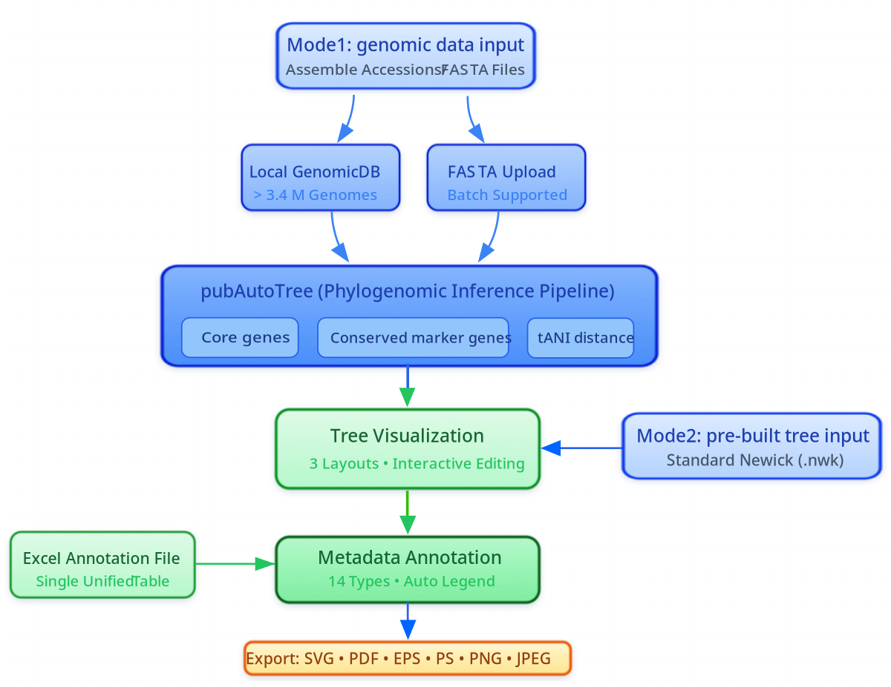

<div align="center">

# pubTreeServer

### An All-in-One Web Platform from Genomic Sequences to Publication-Ready, Annotated Phylogenomic Trees

**Automated phylogenomic inference · Interactive tree editing · 14 annotation types · Publication-ready export**

[**Online platform ↗**](https://mgs.microbialgenomic.cn/pubTreeServer) · [**Run pubAutoTree ↗**](https://mgs.microbialgenomic.cn/pubTreeServer/pubAutoTree/user_request) · [**Open TreeVisualizer ↗**](https://mgs.microbialgenomic.cn/pubTreeServer/TreeVisualizer)

[**User guide ↗**](https://mgs.microbialgenomic.cn/pubTreeServer/usage) · [**Tree gallery ↗**](https://mgs.microbialgenomic.cn/pubTreeServer/tree_gallery) · [**Local installation ↗**](https://mgs.microbialgenomic.cn/pubTreeServer/local-install)

### [⬇ Download the pubTreeServer local deployment package](https://www.microbialgenomic.cn/pubtreeserverData/pubTreeServer_local.tar.gz)

</div>

---

## Overview

**pubTreeServer** is a web platform that connects **pubAutoTree**, an automated phylogenomic inference pipeline, with **TreeVisualizer**, an interactive system for visualization, annotation and figure customization. It supports a continuous workflow from genome input to annotated phylogenomic figures; researchers with a precomputed tree can start directly in TreeVisualizer.

> **Repository purpose:** This GitHub repository is the **project information, documentation and download portal**. The local software distribution is hosted externally at the official download URL above. The application archive is **not** stored in Git history; downloading or cloning this repository does not install pubTreeServer.

## Choose your workflow

| | Mode 1 — Genome input | Mode 2 — Pre-built tree input |
|---|---|---|
| **Input** | NCBI assembly accessions or FASTA genome assemblies | Newick tree file (`.nwk`) |
| **Workflow** | pubAutoTree → inferred phylogeny → TreeVisualizer | TreeVisualizer directly |
| **Start** | [Run pubAutoTree ↗](https://mgs.microbialgenomic.cn/pubTreeServer/pubAutoTree/user_request) | [Open TreeVisualizer ↗](https://mgs.microbialgenomic.cn/pubTreeServer/TreeVisualizer) |

<p align="center"></p>

## Core features

| Component | Capabilities |
|---|---|
| **pubAutoTree** | Phylogenomic inference from FASTA genomes or NCBI assembly accessions (retrieving via a [server-hosted genomicDB ↗](https://mgs.microbialgenomic.cn/pubTreeServer/pubAutoTree/genomicDB) containg more than 3.4 M genomes from NCBI genomic database); multiple inference methods, with analysis-dependent quality control and recombination filtering. |
| **TreeVisualizer** | Rectangular, circular and unrooted tree layouts; interactive tree editing and real-time figure customization. |
| **Excel-based annotation** | A unified annotation spreadsheet, **14 supported annotation types**, global settings and column-specific controls. |
| **Publication-ready export** | Export publication-ready figures in SVG, PDF, EPS, PS, PNG and JPEG formats. |
| **Save and share configuration** | Save the current visualization and annotation settings, then share the saved URL for collaborative review and continued editing. |
| **Tree gallery** | Ten online examples with views, editable copies and downloadable example data. |
| **Local deployment** | Precompiled web frontend and backend, bundled workflow scripts, and configurable local genomic database support. |

### 14 supported annotation types

`leafnode` · `leafbranch` · `leafdashedbranch` · `leafclade` · `label` · `clade` · `binaryplot` · `heatmap` · `bar` · `stack` · `line` · `scatterplot` · `bubble` · `pie`

Read the [annotation type reference](docs/annotations.md) or the [official usage guide](https://mgs.microbialgenomic.cn/pubTreeServer/usage) for Excel format and configuration details.

## Download and local installation

**Canonical download (hosted outside GitHub):**

https://www.microbialgenomic.cn/pubtreeserverData/pubTreeServer_local.tar.gz

On Linux or macOS, download and unpack:

```bash
curl -fL --retry 3 -o pubTreeServer_local.tar.gz \
  https://www.microbialgenomic.cn/pubtreeserverData/pubTreeServer_local.tar.gz
tar -xzf pubTreeServer_local.tar.gz
cd pubTreeServer_local
```

Or use the included helper: `bash scripts/download_pubTreeServer.sh`. Download size may change with new builds. **Extraction alone is not sufficient for deployment:** install and configure Java 8, Redis, Node.js, the appropriate Perl/Python runtime and the phylogenetic analysis tools used by your workflow. Follow the [local installation summary](docs/installation.md) and [official deployment guide ↗](https://mgs.microbialgenomic.cn/pubTreeServer/local-install).

The inspected distribution contains `front-End/dist/`, `back-End/pubTreeServer.jar`, `main.pl`, `MGOAP.pl`, `bin/`, `subprogram/` and `db/`. It is primarily a **local deployment distribution**, not a standalone GitHub source checkout.

## Examples and documentation

| Resource | Description |
|---|---|
| [Usage guide ↗](https://mgs.microbialgenomic.cn/pubTreeServer/usage) | Inputs, operations, annotation table and export. |
| [Tree gallery ↗](https://mgs.microbialgenomic.cn/pubTreeServer/tree_gallery) | Ten interactive visualization and annotation examples. |
| [Example-data links](docs/gallery.md) | Direct `.nwk` downloads for Examples 01–10 and `.xlsx` for Examples 05–10. |
| [Local installation ↗](https://mgs.microbialgenomic.cn/pubTreeServer/local-install) | Authoritative dependency and deployment instructions. |
| [Quick start](docs/quick-start.md) | Which entry point to choose and what to do first. |
| [FAQ](docs/faq.md) | Common download, setup and repository questions. |

### Example gallery preview

| Example | Focus | Online example | Example data |
|---|---|---|---|
| **01** | Basic rectangular phylogeny | [View ↗](https://mgs.microbialgenomic.cn/pubTreeServer/TreeVisualizer?galleryExample=basic-rectangle) | [NWK ↓](https://www.microbialgenomic.cn/pubtreeserverData/tree_gallery_example_data/example01.nwk) |
| **02** | Basic circular phylogeny | [View ↗](https://mgs.microbialgenomic.cn/pubTreeServer/TreeVisualizer?galleryExample=basic-circular) | [NWK ↓](https://www.microbialgenomic.cn/pubtreeserverData/tree_gallery_example_data/example02.nwk) |
| **03** | Basic unrooted phylogeny | [View ↗](https://mgs.microbialgenomic.cn/pubTreeServer/TreeVisualizer?galleryExample=basic-unrooted) | [NWK ↓](https://www.microbialgenomic.cn/pubtreeserverData/tree_gallery_example_data/example03.nwk) |
| **04** | Selected-element styling and interactive editing | [View ↗](https://mgs.microbialgenomic.cn/pubTreeServer/TreeVisualizer?galleryExample=interactive-editing) | [NWK ↓](https://www.microbialgenomic.cn/pubtreeserverData/tree_gallery_example_data/example04.nwk) |
| **05** | Categorical annotation tracks | [View ↗](https://mgs.microbialgenomic.cn/pubTreeServer/TreeVisualizer?galleryExample=categorical-annotation) | [NWK ↓](https://www.microbialgenomic.cn/pubtreeserverData/tree_gallery_example_data/example05.nwk) · [Excel ↓](https://www.microbialgenomic.cn/pubtreeserverData/tree_gallery_example_data/example05.xlsx) |
| **06** | Quantitative annotation tracks | [View ↗](https://mgs.microbialgenomic.cn/pubTreeServer/TreeVisualizer?galleryExample=quantitative-annotation) | [NWK ↓](https://www.microbialgenomic.cn/pubtreeserverData/tree_gallery_example_data/example06.nwk) · [Excel ↓](https://www.microbialgenomic.cn/pubtreeserverData/tree_gallery_example_data/example06.xlsx) |
| **07** | All 14 annotation types with unrooted circular tracks | [View ↗](https://mgs.microbialgenomic.cn/pubTreeServer/TreeVisualizer?galleryExample=multidimensional-annotation) | [NWK ↓](https://www.microbialgenomic.cn/pubtreeserverData/tree_gallery_example_data/example07.nwk) · [Excel ↓](https://www.microbialgenomic.cn/pubtreeserverData/tree_gallery_example_data/example07.xlsx) |
| **08** | Publication-ready annotated figure | [View ↗](https://mgs.microbialgenomic.cn/pubTreeServer/TreeVisualizer?galleryExample=publication-ready) | [NWK ↓](https://www.microbialgenomic.cn/pubtreeserverData/tree_gallery_example_data/example08.nwk) · [Excel ↓](https://www.microbialgenomic.cn/pubtreeserverData/tree_gallery_example_data/example08.xlsx) |
| **09** | Large-tree visualization and editing | [View ↗](https://mgs.microbialgenomic.cn/pubTreeServer/TreeVisualizer?galleryExample=large-tree) | [NWK ↓](https://www.microbialgenomic.cn/pubtreeserverData/tree_gallery_example_data/example09.nwk) · [Excel ↓](https://www.microbialgenomic.cn/pubtreeserverData/tree_gallery_example_data/example09.xlsx) |
| **10** | Save, reopen and continue editing | [View ↗](https://mgs.microbialgenomic.cn/pubTreeServer/TreeVisualizer?galleryExample=save-recover) | [NWK ↓](https://www.microbialgenomic.cn/pubtreeserverData/tree_gallery_example_data/example10.nwk) · [Excel ↓](https://www.microbialgenomic.cn/pubtreeserverData/tree_gallery_example_data/example10.xlsx) |

*Examples 01–04 have Newick test files only; Excel annotation test files are provided for Examples 05–10.*


## Contact

**Contact:** Dr. Xiangyang Li — [lixiangyang@fudan.edu.cn](mailto:lixiangyang@fudan.edu.cn) · [lixiangyang1984@hotmail.com](mailto:lixiangyang1984@hotmail.com)

**Lab website:** kaili University, [Bacterial Genomic Data Mining & Bioinformatic Analysis](https://www.microbialgenomic.cn/)

**License:** This documentation portal does not add or imply a new license for the externally hosted software distribution. See [LICENSE_NOTICE.md](LICENSE_NOTICE.md).

---

<sub>Maintainer note: to publish this repository, upload the *contents* of the portal ZIP to the root of a public GitHub repository. See [GITHUB_UPLOAD_GUIDE_中文.md](GITHUB_UPLOAD_GUIDE_中文.md). An optional static GitHub Pages landing page is provided in <code>docs/index.html</code>.</sub>
